<picture>
  <source media="(prefers-color-scheme: dark)" srcset="docs/readme/banner-dark.svg">
  
</picture>

[](https://github.com/binayakmandal-hash/scamshield-ai/actions/workflows/tests.yml)


-1A73E8)


Checks suspicious emails, WhatsApp chats, UPI payment requests and phone calls, **shows the exact words that look like a scam**, tells you what to do next, and **learns from every decision you make**.

**[Try the live demo](https://scamshield-ai-yln0.onrender.com)**. The demo inbox works without signing in. It runs on Render's free plan, so the first load can take about a minute.

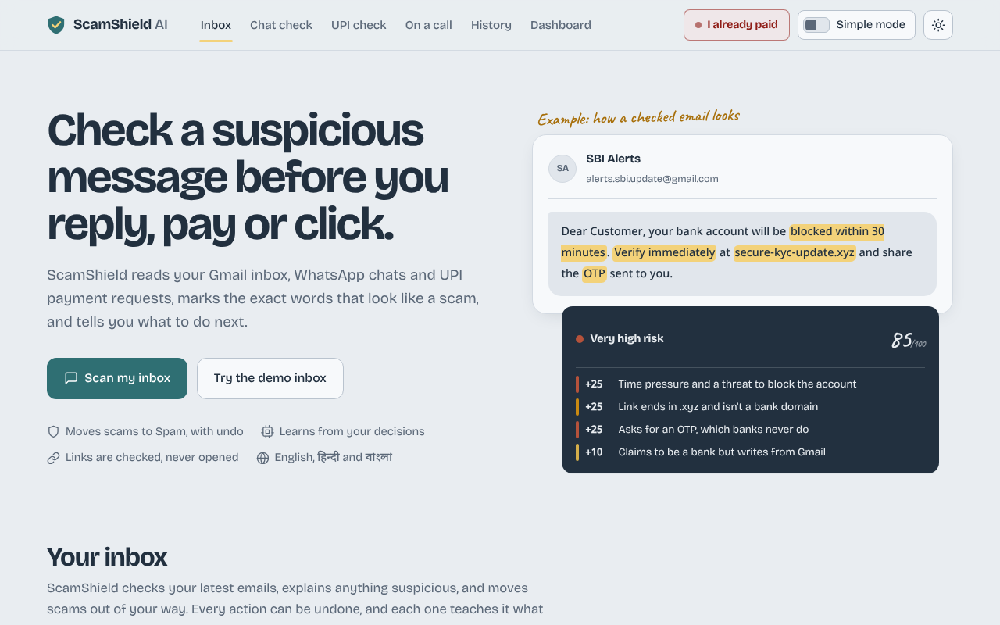

## The problem

*"Your SBI account will be blocked in 30 minutes. Verify now."* Messages like this reach millions of inboxes in India every day: fake bank alerts, job offers that ask for a "registration fee", scholarships that need your OTP, lottery wins you never entered.

Spam filters miss the personal ones. When they do catch one, they never say **why**, so the next slightly different scam still works. The people most at risk, such as parents, grandparents and first-time internet users, get no explanation in their own language.

## What ScamShield does

1. **Scans your Gmail inbox** and scores every email from 0 to 100.
2. **Explains the warning signs** by highlighting the exact phrases in the email. Click any highlight to see why it matters.
3. **Shows its working**: the score is the sum of named signals, each backed by a quote. No black box.
4. **Acts with one click**: move to Spam, block the sender or mark as safe. **Everything can be undone.**
5. **Learns from you**: each decision retrains a local model, so the next scan is more accurate for *your* inbox.
6. **Speaks your language**: explanations in English, हिन्दी and বাংলা, and a ready-to-forward note for your family.

## Beyond email: four safety tools

Scams in India mostly arrive on WhatsApp, as UPI requests and as phone calls, so ScamShield has a tool for each. None of them needs a sign-in.

| Tool | What it does |
|---|---|
| **Chat check** (scam script tracker) | Most scams follow a script. Paste a chat or upload a WhatsApp export (`.txt` or `.zip`), and ScamShield shows which of 9 known scripts it follows (task scam, digital arrest, fake KYC, OLX QR trick and more), **which step it has reached**, and **what they will ask for next**. Every step is backed by a quote from the chat. |
| **UPI check** (UPI translator) | Upload a QR code or payment-request screenshot. ScamShield decodes the QR, reads the text and says in plain English, Hindi or Bengali **which way the money moves, how much, and to whom**. It catches "scan to receive", "approve to get cashback", "sent by mistake, please return" and payee names that don't match the claimed company. |
| **On a call** (call copilot) | Put a suspicious call on speaker. The page listens with the browser's speech recognition and warns the moment it hears a pressure tactic (fake police, "don't tell anyone", OTP, "safe RBI account", AnyDesk), with a line to say and a one-tap call to a family member. The call never reaches ScamShield's server. |
| **I already paid** (golden hour) | A calm, ordered checklist for the first hour after a fraud (1930, your bank, cybercrime.gov.in, locking accounts, the "recovery" second scam), with a timer since payment. Upload the payment screenshot and it fills in the amount, UTR and payee, and drafts the complaint and the message to your bank. |

<table>
  <tr>
    <td width="50%">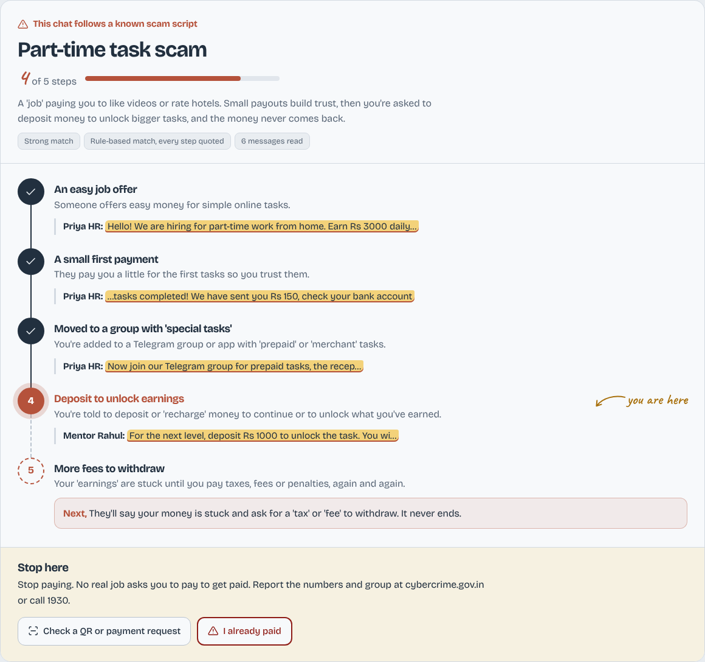<br><sub><b>Chat check.</b> Step 4 of 5 of a task scam, with the next move.</sub></td>
    <td width="50%">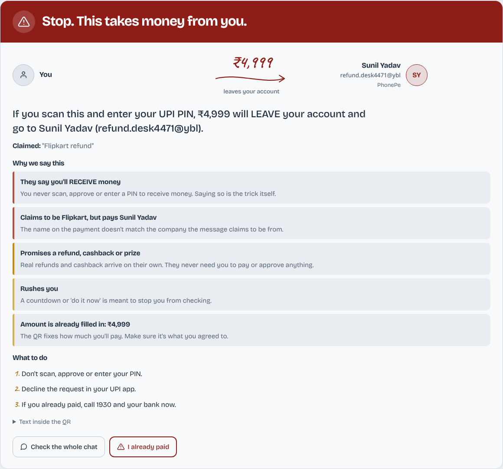<br><sub><b>UPI check.</b> A "refund" QR that actually takes ₹4,999.</sub></td>
  </tr>
  <tr>
    <td>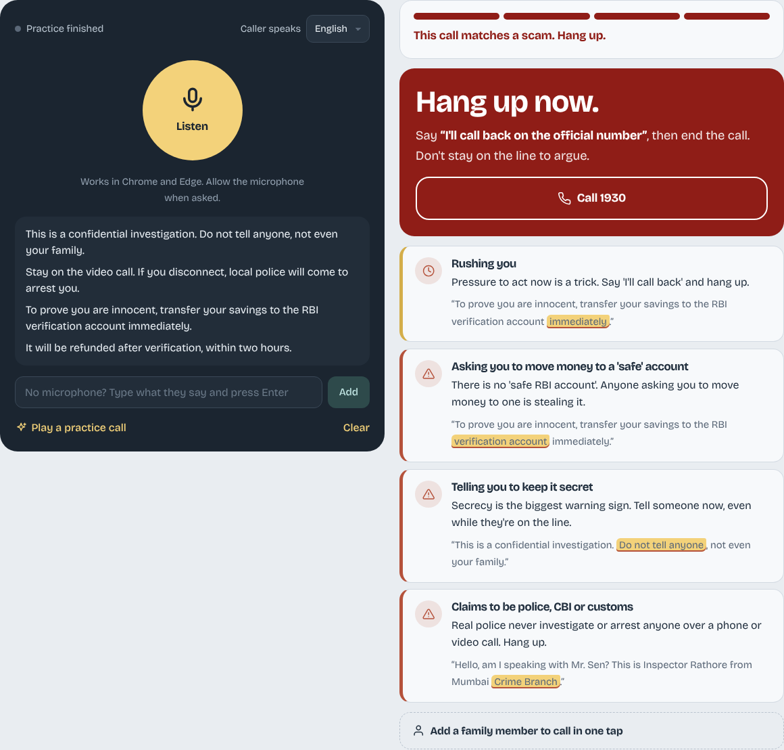<br><sub><b>On a call.</b> A practice "digital arrest" call, flagged live.</sub></td>
    <td>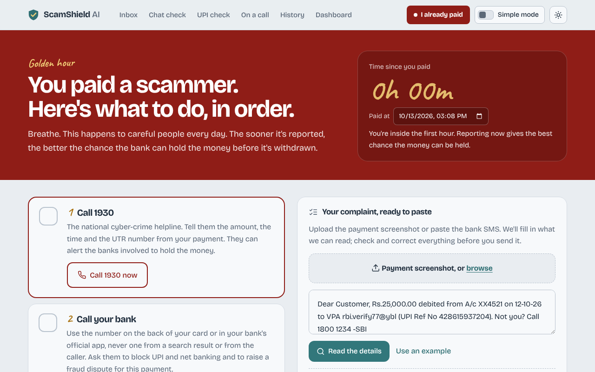<br><sub><b>I already paid.</b> What to do first, in order.</sub></td>
  </tr>
</table>

## How well it works

Measured on hand-written test cases that were never used to tune the rules (offline rule engine, no AI model):

| Tool | Catches scams | False alarms |
|---|---|---|
| Message analyzer | 11 of 12 | 0 of 12 |
| Chat check | 7 of 10 (right script every time) | 0 of 5 |
| UPI check | 5 of 6 | 0 of 6 |
| Call copilot | 7 of 7 | 0 of 5 |

These sets are small and written by the same author as the rules, so real-world accuracy will be lower. What it missed and why: **[docs/EVALUATION.md](docs/EVALUATION.md)**. Reproduce with `python -m evaluation.evaluate_tools`.

## Screenshots

<table>
  <tr>
    <td width="50%">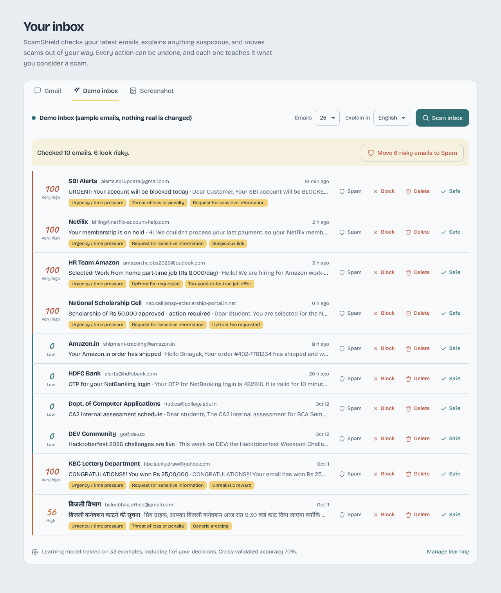<br><sub><b>Inbox.</b> Every email scored, scams on top, actions on each row.</sub></td>
    <td width="50%">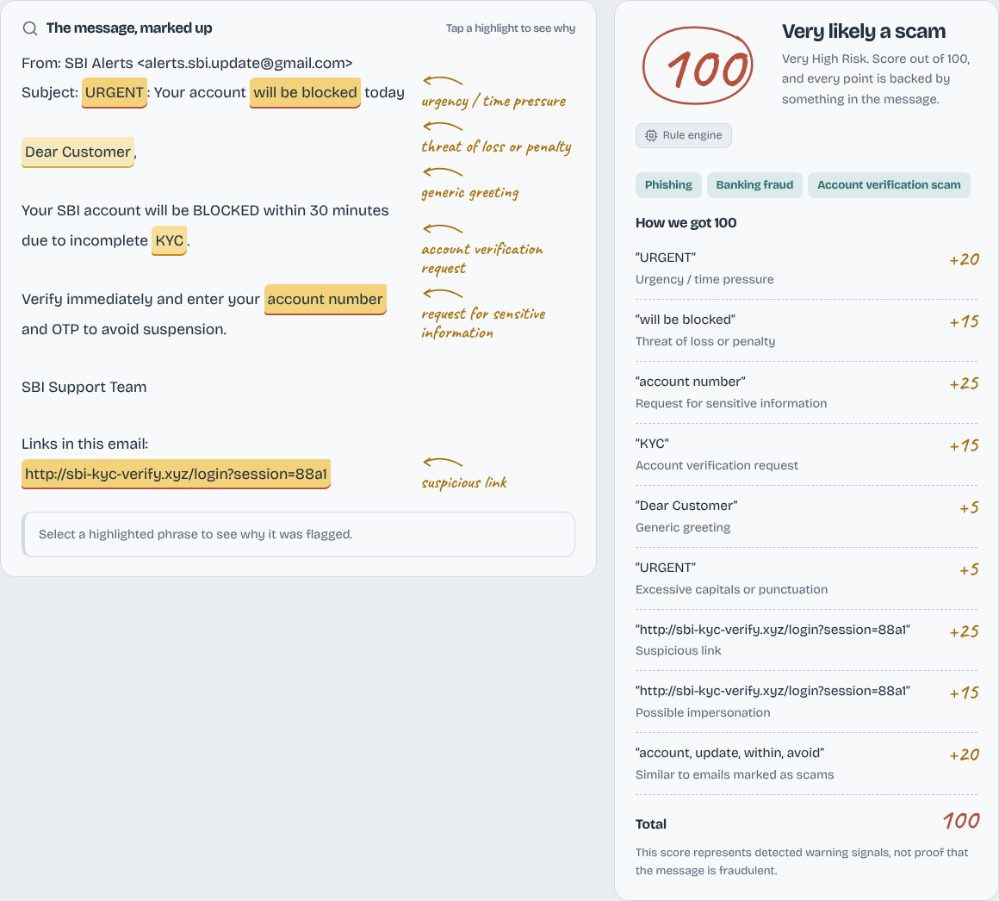<br><sub><b>Analysis.</b> Highlighted evidence and a point-by-point score.</sub></td>
  </tr>
  <tr>
    <td>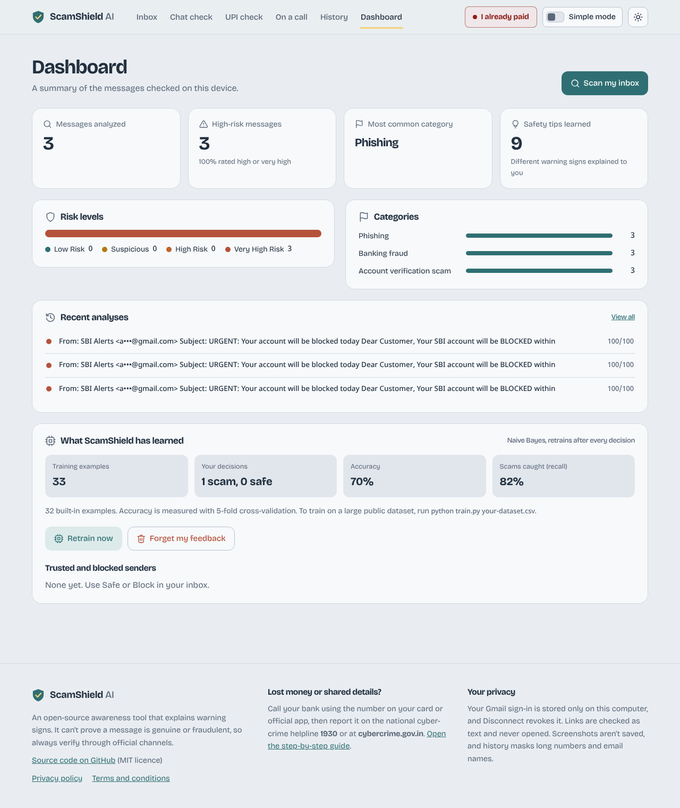<br><sub><b>Dashboard.</b> What the model has learned, with cross-validated accuracy.</sub></td>
    <td>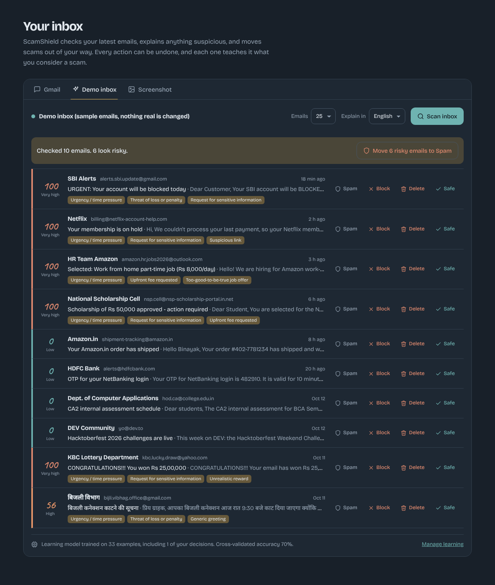<br><sub><b>Dark mode</b>, following your system setting.</sub></td>
  </tr>
</table>

<p align="center">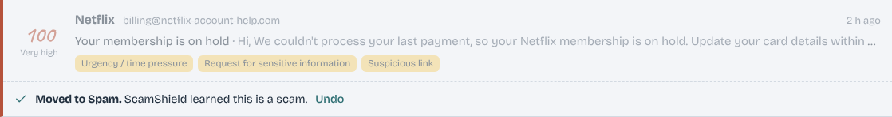<br><sub>Every action can be undone, and every action teaches the model.</sub></p>

## Features

| Feature | Details |
|---|---|
| **Gmail inbox scan** | Official Google sign-in (OAuth 2.0). Scans your latest 10-50 emails. |
| **Evidence highlighting** | Suspicious phrases highlighted in the email itself, coloured by strength. |
| **Transparent score** | Sum of named signals. The server rebuilds the score from evidence, so the AI can't invent numbers. |
| **Quote verification** | Every quote from the AI is checked against the email. Paraphrases are labelled and count for half. |
| **Safe link analysis** | Real destinations behind HTML buttons, look-alike domains (`sbi-kyc-verify.xyz`), typosquats (`amazom.in`), shorteners, risky endings. **Links are never opened.** |
| **Sender verification** | Gmail's SPF / DKIM / DMARC results. A failed check adds points; a verified official domain lowers them. Free providers (gmail.com) never count as verified. |
| **Learns from you** | Spam / Block / Delete / Safe each become training data for a Naive Bayes model that retrains in milliseconds. |
| **Dataset training** | `python train.py dataset.csv` imports public phishing or spam datasets. |
| **Reversible actions** | Spam, Block (Gmail filter), Delete (to Trash) and Safe, each with Undo, plus "Move all risky to Spam". |
| **Send to family** | A short, link-free warning note in English, Hindi or Bengali to forward on WhatsApp. |
| **Ask ScamShield** | Follow-up chat: *"Which part should I worry about?"*, *"I already clicked, what now?"* |
| **Screenshot check** | Upload a WhatsApp or SMS screenshot; Gemma 4 reads the text. |
| **Multilingual** | Detects English, Hindi, Bengali and Hinglish scam patterns. |
| **Simple mode** | Bigger text, plain answers and big buttons for parents and grandparents, switchable on every page. |
| **Demo inbox** | Ten realistic sample emails to try every feature without a Google account. |
| **Works offline** | A built-in rule engine takes over if the AI model is unavailable. |

## How it works

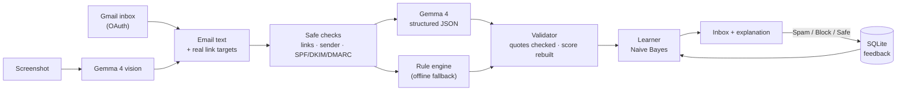

Three layers work together:

- **Fixed checks** handle facts: is this domain really `hdfcbank.com`? Did the sender pass DMARC?
- **Gemma 4** handles meaning: urgency, impersonation, too-good-to-be-true offers, Hinglish.
- **The learner** handles *your* definition of a scam, learned from your clicks.

A validator sits between the AI and the screen, so every quote and every point can be checked. More detail is in [docs/ARCHITECTURE.md](docs/ARCHITECTURE.md).

## Quick start

**Requirements:** Python 3.10+ and Git.

```bash
git clone https://github.com/binayakmandal-hash/scamshield-ai.git
cd scamshield-ai

python -m venv .venv
# Windows:
.venv\Scripts\activate
# macOS / Linux:
source .venv/bin/activate

pip install -r requirements.txt
cp .env.example .env          # Windows: copy .env.example .env
python app.py
```

Open **http://127.0.0.1:5000**. The **Demo inbox** works straight away, with no keys needed.

### Turn on the AI (Gemma 4)

Choose one option in `.env`:

| Option | Settings | Best for |
|---|---|---|
| **Hosted Gemma 4** (free key from [Google AI Studio](https://aistudio.google.com/apikey)) | `AI_PROVIDER=openai`<br>`OPENAI_BASE_URL=https://generativelanguage.googleapis.com/v1beta/openai`<br>`OPENAI_API_KEY=your-key`<br>`OPENAI_MODEL=gemma-4-26b-a4b-it` | Quick setup, any laptop |
| **Local Gemma 4** via [Ollama](https://ollama.com) | `AI_PROVIDER=ollama`<br>`OLLAMA_MODEL=gemma4:e4b`<br>then run `ollama pull gemma4:e4b` | Fully private and offline |
| **No AI** | `AI_PROVIDER=none` | Rule engine only |

The label at the top right of the app (on wide screens) shows which engine is active.

### Connect Gmail

Create a free OAuth client in Google Cloud, which takes about 10 minutes, then click **Connect Gmail**.
**Step-by-step guide: [docs/GMAIL_SETUP.md](docs/GMAIL_SETUP.md)**

### Train the model

```bash
python train.py path/to/phishing_dataset.csv
```
**Datasets, columns and accuracy: [docs/TRAINING.md](docs/TRAINING.md)**

## Deploy online

[](https://render.com/deploy?repo=https://github.com/binayakmandal-hash/scamshield-ai)

The repo includes a [`render.yaml`](render.yaml) blueprint for Render's free plan. Deployed sites run in **public mode**: each visitor gets a private session with their own Gmail sign-in, history and learning, and AI calls are rate-limited per visitor.
**Full guide: [docs/DEPLOY_RENDER.md](docs/DEPLOY_RENDER.md)**

## Configuration

All settings live in `.env` (see [`.env.example`](.env.example)):

| Variable | Default | Purpose |
|---|---|---|
| `AI_PROVIDER` | `ollama` | `ollama`, `openai` (any OpenAI-compatible server) or `none` |
| `OPENAI_BASE_URL` / `OPENAI_API_KEY` / `OPENAI_MODEL` | (empty) | Hosted open-weight model |
| `OLLAMA_HOST` / `OLLAMA_MODEL` | `localhost:11434` / `gemma4:e4b` | Local model |
| `GOOGLE_CLIENT_ID` / `GOOGLE_CLIENT_SECRET` | (empty) | Gmail OAuth (or use `client_secret.json`) |
| `GMAIL_REDIRECT_URI` | `http://127.0.0.1:5000/oauth2callback` | Must match Google Cloud exactly |
| `GMAIL_SCAN_LIMIT` | `25` | Emails per scan |
| `SAVE_HISTORY` | `true` | Save analyses to the local database |
| `REDACT_STORED_MESSAGES` | `true` | Mask OTPs, phone numbers and email names before saving |
| `PUBLIC_MODE` | `false` | `true` on a public website: a private session per visitor |
| `AI_REQUESTS_PER_HOUR` | `60` | Per-visitor AI limit in public mode |

## Project structure

```
scamshield-ai/
├── app.py                 Flask app: pages, screenshot and analysis API
├── mail_routes.py         Gmail sign-in, inbox scan, actions, learning API
├── tools_routes.py        Chat check, UPI check, call copilot and golden hour
├── train.py               Train the learner on a CSV dataset
├── users.py               Current user: "local", or a private id per visitor in public mode
├── render.yaml            One-click Render deployment
├── config.py · database.py
├── services/
│   ├── gmail_client.py    Gmail REST API + OAuth (requests only)
│   ├── email_pipeline.py  Email scoring: sender verification, learner, trusted senders
│   ├── ai_analyzer.py     Gemma 4 clients (Ollama / OpenAI-compatible) + pipeline
│   ├── prompt_builder.py  All prompts and the JSON contract
│   ├── schema.py          Validates AI output: quotes, score, safe wording
│   ├── rule_engine.py     Offline analyzer (English / Hindi / Bengali)
│   ├── learner.py         Naive Bayes that learns from feedback
│   ├── url_analyzer.py    Text-only link checks
│   ├── sender_analyzer.py Sender identity checks
│   ├── brands.py          Commonly impersonated brands and official domains
│   ├── scam_scripts.py    Scam script library and chat tracker
│   ├── upi_check.py       QR decoding and "which way does the money go"
│   ├── call_tactics.py    Pressure tactics for the call copilot (shared with the browser)
│   ├── payment_receipt.py Reads amount, UTR and payee from a payment receipt
│   ├── seed_data.py       Built-in training examples
│   └── demo_inbox.py      Sample mailbox
├── templates/ · static/   UI (HTML, CSS, vanilla JS; no build step)
├── evaluation/            Held-out test cases and the evaluation script
├── tests/                 75 unit and integration tests (no network needed)
└── docs/                  Guides and screenshots
```

## Privacy and safety

- **Your Gmail sign-in stays on your computer** (`gmail_token.json`, git-ignored). **Disconnect** revokes it at Google. On a deployed site, each visitor's sign-in, history and learning are private to their own session.
- **Links are never opened.** All URL checks run on the text.
- **Nothing is permanently deleted.** Delete moves to Trash (30 days), and every action has Undo.
- **It never sends email.**
- **Chats, QR codes and receipts aren't saved**, and on a call, the audio and transcript never reach the server.
- **Saved history masks** OTPs, phone, account and Aadhaar numbers, and email usernames.
- **No false certainty.** It never says "definitely a scam"; scores show their evidence.

Full details: [docs/PRIVACY.md](docs/PRIVACY.md), and the app's own [privacy policy](https://scamshield-ai-yln0.onrender.com/privacy) and [terms](https://scamshield-ai-yln0.onrender.com/terms) pages. To report a vulnerability, see [SECURITY.md](SECURITY.md).

## Running the tests

```bash
python -m unittest discover -s tests -t .
```

The tests mock Gmail and the AI, so they need no account or internet. They run on every push via GitHub Actions.

## Roadmap

- [ ] **Auto-protect mode**: background scans that move very-high-risk emails to Spam
- [ ] **Family protection**: watch a parent's inbox and get alerts
- [x] **WhatsApp chat check**: upload an export and see the scam script it follows
- [x] **UPI check, call copilot and golden-hour guide**
- [ ] **WhatsApp / Telegram bot**: forward a message, get the analysis
- [ ] **Chrome extension**: warnings inside Gmail itself
- [ ] **Voice explanations** in Hindi and Bengali for elderly users
- [ ] **A public, labelled test set** of Indian scam chats, to replace the hand-written one
- [ ] **More languages**: Tamil, Telugu, Marathi
- [ ] Pre-trained model on a large public phishing dataset

## Contributing

Contributions are welcome, especially new scam patterns in Indian languages, impersonated brands, and reports of wrong results. Read [CONTRIBUTING.md](CONTRIBUTING.md) and the [Code of Conduct](CODE_OF_CONDUCT.md).

## Tech stack

**Backend:** Python, Flask, SQLite · **AI:** Gemma 4 (open weights) via Google AI Studio or Ollama · **Learning:** multinomial Naive Bayes (pure Python) · **Email:** Gmail REST API with OAuth 2.0 · **Frontend:** HTML, CSS, vanilla JavaScript, no build step · **QR:** OpenCV · **CI:** GitHub Actions

## Acknowledgements

- [Gemma](https://ai.google.dev/gemma) by Google DeepMind (Apache 2.0) and [Ollama](https://ollama.com)
- [Gmail API](https://developers.google.com/gmail/api)
- Built for **Hacktoberfest 2026**, whose theme is "AI belongs to everyone"

## License

[MIT](LICENSE) © 2026 Binayak Mandal

---

<sub>ScamShield AI explains warning signs. It cannot prove that a message is genuine or fraudulent, so always verify through official channels. **In India, report cyber fraud at [cybercrime.gov.in](https://cybercrime.gov.in) or call 1930.**</sub>
