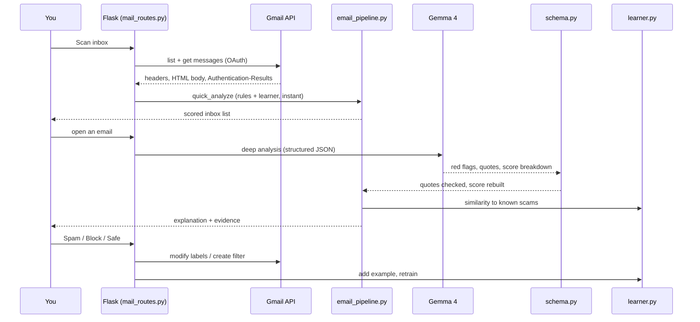

# Architecture

## Pipeline for one email

## Scoring

The risk score is **always the sum of the score breakdown**, clamped to 0-100. The level follows from the score:

| Score | Level |
|---|---|
| 0-24 | Low Risk |
| 25-49 | Suspicious |
| 50-74 | High Risk |
| 75-100 | Very High Risk |

**Signal sources**

| Source | Examples | Points |
|---|---|---|
| Message content (Gemma 4 or rule engine) | urgency, threat, OTP or PIN request, upfront fee, prize, job lure, APK or remote-access lure | +5 to +25 each |
| Link analysis | look-alike or typosquat domain, shortener, `.xyz` / `.top`, raw IP, `@` trick | +15 / +25 |
| Impersonation | claims "SBI" but writes from gmail.com, or links to a non-official domain | +15 |
| Sender verification | DMARC fail | +20 |
| Learner | ≥70% similar to known scams | up to +20 |
| Your blocked senders | none | +30 |
| Verified official sender | DMARC/DKIM pass on an official brand domain (never free providers) | −20 |
| Your trusted senders | none | −40 |

### Avoiding false alarms

- **Negation:** "Never share your OTP" is advice, not a request, so it doesn't count.
- **Request verbs:** an OTP or PIN only counts as requested when a word like *share*, *send*, *enter* or *verify* is nearby. "Your OTP is 4821" is a notification.
- **Strict links in email:** newsletters contain long tracking links, so only clearly risky links count.

## Validation of AI output (`services/schema.py`)

1. Parse JSON (code fences tolerated); retry once if malformed, then fall back to the rule engine.
2. Keep only allowed fields, categories and severities.
3. Check every evidence quote against the email; unverified quotes count for half.
4. Rebuild the score from the breakdown, then derive the level.
5. Soften absolute wording; drop any advice to click links.

## API

| Method | Route | Purpose |
|---|---|---|
| GET | `/gmail/connect` → `/oauth2callback` | Google sign-in |
| GET / POST | `/api/gmail/status`, `/api/gmail/disconnect` | Connection status; revoke |
| POST | `/api/mail/<gmail\|demo>/scan` | `{limit}` → scored inbox |
| GET | `/api/mail/<mode>/<id>?lang=en\|hi\|bn` | Full analysis of one email |
| POST | `/api/mail/<mode>/<id>/action` | `{action: spam\|block\|trash\|safe, undo?: true}` |
| POST | `/api/mail/<mode>/bulk` | `{action: spam\|trash, ids: [...]}` |
| GET | `/api/learning` | Model stats, trusted and blocked senders |
| POST / DELETE | `/api/learning/retrain`, `/api/learning/feedback` | Retrain; forget your feedback |
| DELETE | `/api/learning/sender/<email>` | Remove a trusted or blocked sender (also deletes the Gmail filter) |
| POST | `/api/analyze` | Screenshot analysis (multipart `image`, `language`) |
| POST | `/api/action-plan`, `/api/eli12`, `/api/family-note`, `/api/chat` | Follow-ups for an analysis |
| GET / DELETE | `/api/history`, `/api/history/<id>` | Saved analyses |
| GET | `/api/stats`, `/api/health` | Dashboard numbers; AI status |

## Database (SQLite)

| Table | Contents |
|---|---|
| `analyses` | Opened analyses (masked) for History and Dashboard |
| `training_examples` | Feedback and dataset rows (masked) for the learner |
| `sender_rules` | Trusted and blocked senders, with Gmail filter ids |
| `learner_model` | The trained model and its evaluation stats |

The database is created automatically on first run.

## Design decisions

- **`requests` instead of Google SDKs**, so there are fewer dependencies, it's easy to read, and it's easy to mock in tests.
- **Naive Bayes instead of a deep model**: it trains in milliseconds on a laptop, can be explained in a sentence, and is good for short text with little data.
- **Hybrid scoring**: the AI explains, fixed code checks facts, the learner personalises, and the validator keeps them honest.
- **Reversible by default**: Spam and Trash instead of permanent deletion, so a wrong prediction is never costly.
